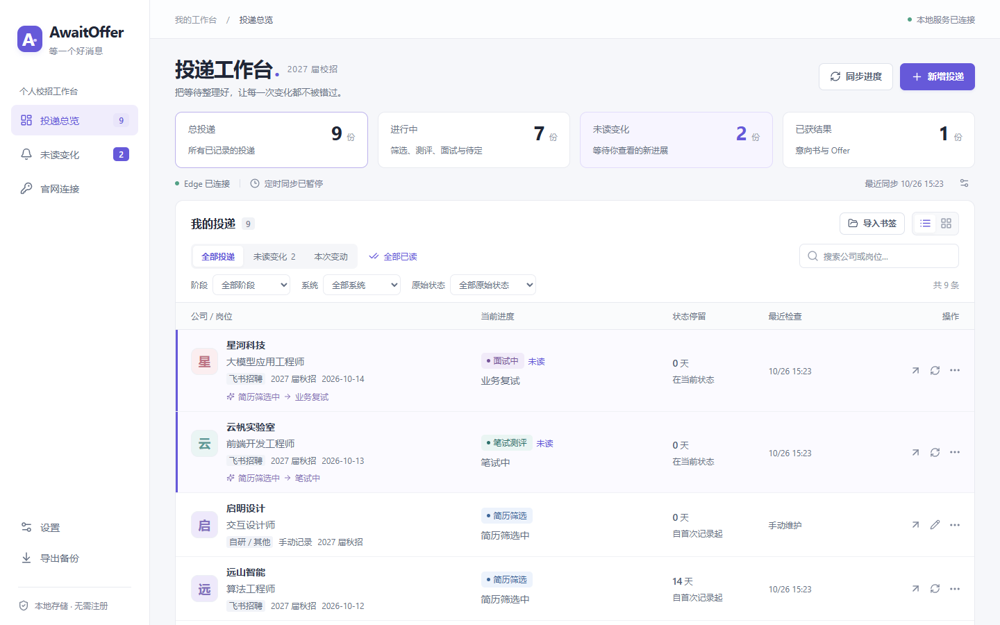
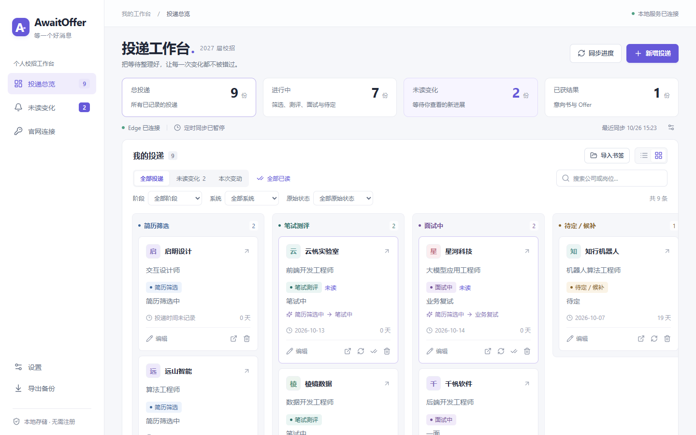
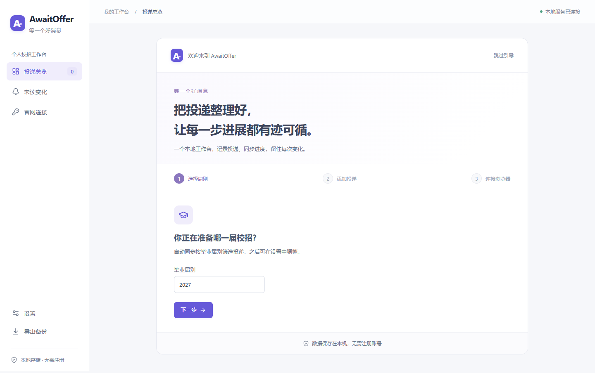

<p align="center">
  
</p>

<h1 align="center">AwaitOffer</h1>

<p align="center"><strong>等一个好消息，也记下每一步进展。</strong></p>
<p align="center">把散落在招聘官网的校招进度，整理到一个本地工作台。</p>
<p align="center">Windows · Microsoft Edge · React · TypeScript · SQLite · MIT</p>



> 截图中的公司、岗位和投递均为虚构示例，由隔离的演示数据生成。

AwaitOffer 是一个运行在自己电脑上的校招投递管理工具。你可以独立使用手动记录，也可以通过 Edge 扩展，同步已适配官网的投递进度。无需注册账号或安装数据库服务。

## 能做什么

- **集中管理投递**：手动添加或选择 Edge 书签文件夹导入，支持同一公司的多个岗位。
- **发现每次变化**：保留官网原始状态、标准阶段和历史时间轴；变化保持未读，直到你主动标记。
- **同步官网进度**：复用当前 Edge 的有效登录，手动或定时检查；登录失效、验证码和读取异常分别提示。
- **掌握自己的数据**：SQLite 保存在本机，支持 JSON 导出和恢复；查询失败保留最后成功读取的进度。

<details>
<summary>查看进度看板与首次使用引导</summary>




</details>

## 快速开始

需要 **Windows、已安装的 Microsoft Edge，以及 Node.js 24.15 及以上的 24.x 版本**。项目的 [`.node-version`](.node-version) 记录开发与 CI 使用的版本。

下载项目源码并解压，在项目目录的 PowerShell 中执行：

```powershell
npm.cmd ci
npm.cmd run build
npm.cmd start
```

打开 **http://127.0.0.1:3180**。也可以双击 [`Start-AwaitOffer.cmd`](Start-AwaitOffer.cmd)，脚本会安装缺失的依赖、构建并启动服务。

首次打开可以选择毕业届别、添加投递，并按需连接浏览器。引导允许跳过；手动记录不需要扩展或 AI 密钥。关闭服务窗口或按 `Ctrl+C` 停止程序，已保存的数据会保留。

## 连接 Edge，开启同步

1. 保持本地服务运行，在 Edge 打开 `edge://extensions`，开启“开发人员模式”。
2. 点击“加载解压缩的扩展”，选择项目中的 **`extension`** 文件夹；先完成上面的构建。
3. 点击工具栏中的 AwaitOffer 扩展，再点击“连接 AwaitOffer”。
4. 回到工作台，在“官网连接”中连接公司；需要时在原官网完成登录和验证码。

同步使用独立的后台窗口，最多复用 3 个自动查询标签页。已存在的日常页面不会被移动或关闭。需要人工处理时，工作台提供对应入口。

定时同步需要 **本地服务、Edge 和扩展持续运行**；面板标签页可以关闭。默认间隔为 24 小时，可在设置中调整。电脑关机、服务退出或浏览器关闭时不会继续同步。

## 支持范围

| 方式／招聘平台       | 当前范围                                                     |
| -------------------- | ------------------------------------------------------------ |
| 手动记录             | 所有可保存官网链接的投递，可独立使用                         |
| 飞书招聘、Moka、北森 | 已有适配器及部分站点验证；不同公司和页面版本仍需核对         |
| 自建招聘官网         | 部分站点实现字段解析，覆盖情况见[适配说明](docs/adapters.md) |
| 书签导入             | 本机 Windows Edge 的默认配置，可选择文件夹，包含子目录       |

**提供入口或实现解析，不等于该站点已验证可用。** 官网改版、登录过期、验证码和字段缺失都可能中断同步。程序不自动获取短信、不绕过验证码，也不能延长官网会话有效期。

首次成功读取建立状态基线，后续变化才产生未读提示。未知状态保留为待分类，失败时不会编造或覆盖已有进度。当前主要面向校招，自动导入按所选毕业届别筛选，排除明确的实习与社招。

## 数据与隐私

- 投递、历史和设置保存在项目的 `data/` 目录，该目录不进入 Git。
- 扩展只访问清单中的招聘站点和本机接入服务，不申请 Cookie、密码、调试器或所有网站访问权限。
- JSON 备份不包含官网登录状态、扩展配对令牌或 AI 密钥；恢复前自动保存当前数据。见[备份与恢复](docs/backup.md)。
- **可选 AI 辅助识别会访问 xAI**：配置密钥后，部分自建站点可能向 xAI 发送接口字段结构和经过处理的样例，其中可能包含岗位、状态、时间等短文本。未配置时不调用该功能，已知平台的常规解析不依赖它。
- 服务默认只监听本机，不提供公网部署或云端账号系统。项目并非完全离线：官网同步需要访问招聘网站。

提交反馈时，请勿上传真实数据库、备份、简历、配对令牌或未经检查的招聘响应。更详细的数据流见[使用说明](docs/usage.md)。

## 开发与贡献

```powershell
npm.cmd run dev        # 前端 http://127.0.0.1:5173
npm.cmd run check      # TypeScript 检查
npm.cmd test           # 单元与 API 测试
npm.cmd run build      # 构建主程序和扩展
npm.cmd run test:ui    # 用本机 Edge 跑隔离的浏览器流程测试
```

测试使用临时数据库、虚构数据和模拟浏览器连接，不访问真实招聘账号或 xAI。浏览器流程测试会拦截接入服务请求，不连接本机已有的扩展服务。

- [使用说明](docs/usage.md) · [常见问题](docs/troubleshooting.md)
- [适配说明](docs/adapters.md) · [备份与恢复](docs/backup.md)
- [开发说明](docs/development.md) · [贡献指南](CONTRIBUTING.md)

项目代码采用 [MIT License](LICENSE)。公司名称、商标和第三方品牌标识归各自权利人所有。
